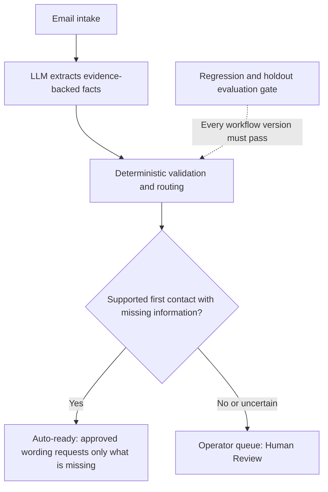

# My Office Intern: governed AI for repetitive email intake

Parking companies get the same emails every day, messy and half complete. I worked inside that inbox, so parking correspondence is where I started.

This is what I built so a person only handles the ones that need a person.

A working, independently built, evaluation-backed proof of concept.

## Verified results

### Fixed 100-email regression

| **96.0%** | **100.0%** | **0** |
|:---:|:---:|:---:|
| Routing accuracy | Auto-ready precision | False auto-ready outcomes |

The result comes from a fixed 100-email regression set with saved case content, permanent case identifiers, and an operations-owned answer key. All four remaining errors were conservative Human Review escalations. No Human Review case was approved for template automation.

This is a controlled regression result, not a production-performance claim.

### Broader 300-case evaluation

A broader evaluation tested the fixed 100-email regression set together with a separate 200-case holdout set.

Version 1.14 achieved 97.3% route accuracy and 97.2% auto-ready precision, but it also produced five false auto-ready outcomes. Those safety failures informed a narrow workflow correction.

The subsequent user-started live-model evaluation of version 1.15 produced:

| **99.0%** | **100.0%** | **0** |
|:---:|:---:|:---:|
| Routing accuracy | Auto-ready precision | False auto-ready outcomes |

All five previously observed false-auto cases moved to Human Review without creating a new false automation. The three remaining disagreements were conservative Human Review routes.

This is a verified fixed-set evaluation, not a production-performance or unseen-traffic claim.

## What the AI is never allowed to do

- Decide whether a violation is valid.
- Claim that an external company database was checked.
- Waive fees, approve appeals, or resolve disputes.
- Invent missing facts or supporting evidence.
- Freely compose an automated customer response.
- Override the deterministic safety gate.

These are product boundaries, not prompt suggestions.

## See it work

<!-- demo clip goes here -->

An inbound email arrived with no subject:

> my plates were stolen and someone parked in your lot. here's the police report number. remove the ticket please.

The intern drafted a polite template reply asking for the violation number, the exact date and time of the visit, payment confirmation, and any photos or screenshots.

The reply was held as a draft for a person to review and send. A Draft/Auto toggle controls this, and the operator can Copy Draft, Regenerate, or Mark as Sent.

[Watch the full demo on LinkedIn](https://www.linkedin.com/feed/update/urn:li:activity:7499106178682048512/)

## How it works

The AI reads and extracts. Code checks the evidence and decides the route. People investigate and make the decisions that matter.

If the diagram does not display, the flow is: email intake, then LLM evidence extraction, then deterministic validation and routing, then either an approved information request or the operator queue. Every workflow version is measured against the fixed regression and holdout sets before it is trusted.

| Responsibility | Role |
|---|---|
| AI understands | Interprets inconsistent language and extracts evidence-backed information |
| Rules control | Validate the extraction, determine what may be automated, and select approved wording |
| People decide | Investigate company records, exercise judgment, and make consequential decisions |

## The first operational slice

The parking-management scenario performs one deliberately narrow job:

1. Read an incoming inquiry.
2. Interpret what the customer is asking and what evidence was supplied.
3. Validate the extraction against the email.
4. Determine whether the supported, approved information-request path applies.
5. Prepare consistent approved wording or retain the case for Human Review.

The system calls the approved response Template Auto Ready. It requests only information that has not already been supplied.

A Human Review outcome keeps the case with an operator, whether or not the AI can also prepare a useful internal brief.

## Why this matters

Operational inboxes receive many messages that need the same initial response. The writing is repetitive, but understanding the customer is not. A general AI assistant can draft a plausible reply. Plausible is not the same as governed, consistent, or safe to send.

The practical ambition is simple: enable an operator to focus on approximately 20 consequential cases instead of manually writing 100 repetitive replies, while earning enough accuracy and consistency to be trusted.

## The pattern

The same approach fits any high-volume inbox where a wrong automated answer is costly.

Each new application would need its own approved scope, required facts, templates, escalation rules, evaluation evidence, and human authority boundaries.

## Built from an operations perspective

My Office Intern was conceived and built independently by Olamide Aborowa, whose professional background is in operations rather than corporate technology.

That perspective shaped the work. Start with the employee's real task. Isolate the smallest useful unit of automation. Define where human judgment must remain. Require measurable evidence before trusting the result.

## What I'd build next

My Office Intern is a working local prototype and evaluation environment, not a production deployment.

1. Confirm the results hold across repeated runs and fresh email collections, while keeping false auto-ready outcomes at zero.
2. Reduce unnecessary Human Review and improve local throughput and the operator experience, without weakening safety.
3. Run in shadow mode with no automated sending, the next step on the project's own validation ladder before any narrow pilot.

## Explore the research

- [Case study: When AI Wasn't the Hard Part](governed-ai-email-intake-case-study.md)
- [Evaluation methodology](docs/evaluation-methodology.md)
- [Governance model](docs/governance-model.md)

## Public repository scope

This repository shares the problem, research approach, governance model, evaluation method, and selected verified results.

Private source code, prompts, answer keys, test emails, detailed routing logic, operating configuration, credentials, and raw evaluation data are intentionally excluded.

## Connect

Conversations with operations leaders, responsible-AI practitioners, and organizations exploring a governed workflow pilot are welcome.

[Connect with Olamide Aborowa on LinkedIn](https://www.linkedin.com/in/mideaborowa/)

© 2026 Olamide Aborowa. All rights reserved.
